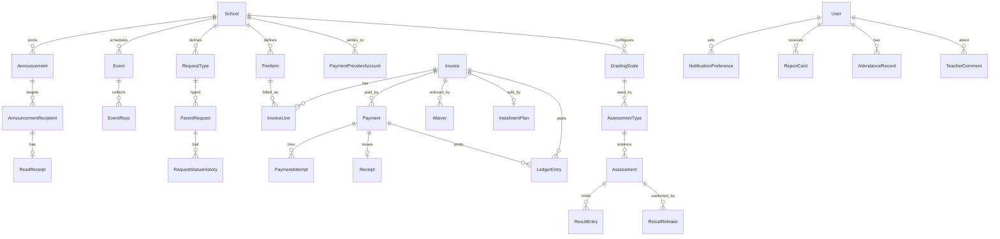

# ERD

Every tenant-scoped entity carries `school_id` (omitted below for readability) and is protected by row-level security. `id` is a UUIDv7 primary key. Timestamps and `deleted_at` are implied.

## Core (section 6)
```mermaid
erDiagram
  School ||--|| SchoolSettings : has
  School ||--o{ Class : has
  School ||--o{ HolidayPackage : offers
  School ||--o{ UserRole : scopes
  User ||--o{ UserRole : holds
  Role ||--o{ UserRole : defines
  User ||--o{ ParentChildLink : guardian
  User ||--o{ ParentChildLink : child
  ParentChildLink ||--|| GuardianPermission : carries
  Class ||--o{ Enrolment : has
  User ||--o{ Enrolment : student
  HolidayPackage ||--o{ PackageSubject : includes
  HolidayPackage ||--o{ StudySlot : "slot options"
  Enrolment ||--o| StudySlot : picks
  Enrolment ||--o{ Session : runs
  Session ||--o{ Attempt : contains
  Session ||--o{ CheckIn : ends_with

  Track ||--o{ Level : has
  Level ||--o{ Subject : has
  Subject ||--o{ Topic : has
  Topic ||--o{ Lesson : has
  Topic }o--o{ Topic : "cross-link (legacy<->new)"
  Lesson ||--o{ Resource : uses
  Subject ||--o{ Paper : has
  Paper ||--o{ Question : has
  Question ||--o| MarkingScheme : has
  Question }o--|| Topic : tagged
  Quiz ||--o{ Question : draws
  Quiz ||--o{ Attempt : taken_as
  Attempt ||--o{ Submission : has
  Submission ||--o| Mark : receives

  Translation ||--o{ BibleVerse : contains
  DevotionEntry }o--o| BibleVerse : cites
  Prayer }o--o| School : "optional school-owned"

  User ||--o{ Message : sends
  MessageThread ||--o{ Message : holds
  User ||--o{ Notification : receives
  User ||--o{ ConsentLog : records
  User ||--o{ AuditLog : acts
```

Notes
- `Resource`: `licence`, `source_url`, `retrieved_at`, `sha256`, `verdict`, `publishable`, `review_status`. Blocked from production if `publishable=false`.
- `Level.track` is `legacy` or `new`; `Topic` cross-links via `topic_link(from_topic, to_topic, relation)`.
- `Paper`, `Question` hold our own tags (level, subject, topic, year, paper, marks, difficulty). Question text is stored only when `Resource.publishable`; otherwise a link-out record.
- `DevotionEntry.review_status`: draft, reviewed_by_chaplain, published.

## School-Parent hub (section 4B.E)


Notes
- `ParentRequest.status`: submitted, seen, in_progress, resolved; each change appends `RequestStatusHistory`.
- `Payment.state`: pending, succeeded, failed, refunded. Transitions go through one function that writes `AuditLog` in the same transaction. `PaymentAttempt` keyed by provider event id for webhook idempotency.
- `LedgerEntry`: append-only, balanced debit/credit lines per transaction. Platform account never holds funds; settlement goes to `PaymentProviderAccount`.
- `ResultEntry.status`: draft, reviewed, published; corrections after publishing create a new audited version, never an overwrite.
- `GradingScale` has no default values in code: scale definitions are data entered after verification against UNEB/NCDC sources (not yet verified).
- Fee balance fields and `ResultEntry` values are field-level encrypted.
- `GuardianPermission`: can_pay, can_view_results, can_message, may_collect.
